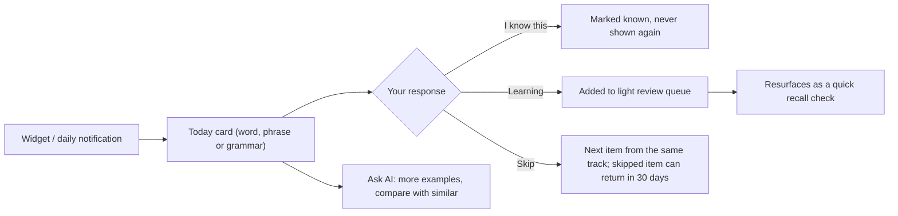
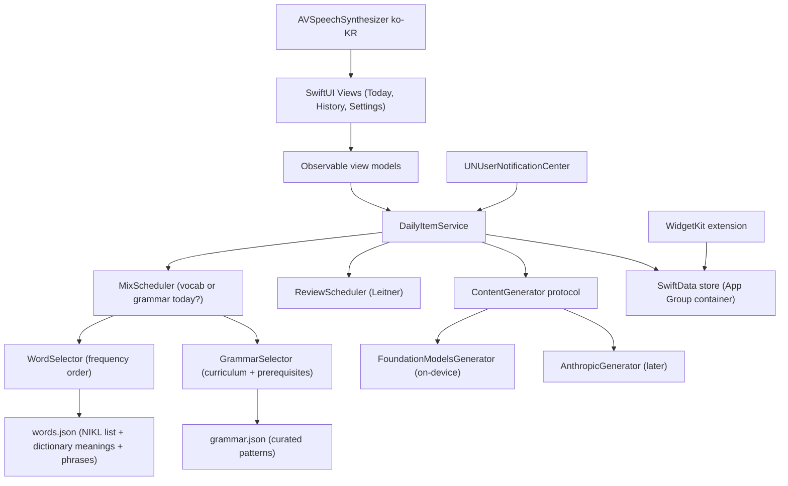

# 오한어 (Ohaneo): Vocab & Grammar iOS App Design

오한어 is short for **오**늘의 **한**국**어** (today's Korean).

## 0. Decisions (from your answers)

| Topic | Decision | Effect on the design |
|---|---|---|
| **Level** | Upper beginner: reads Hangul easily, follows basic conversation | First launch has a **2-minute placement swipe** (about 30 words + 10 grammar patterns, "know / don't know") that sets the starting point. See "Placement" below. |
| **Main problem** | Growing vocabulary *and keeping it* | **Review is in the MVP.** Example sentences use words you've already seen, so each card also revisits old vocabulary. |
| **Grammar** | Include a mix of grammar lessons | Grammar points share the daily slot with vocab (default **2 grammar days a week**). They come from a curated curriculum, and the AI personalizes the examples. See §3. |
| **AI** | Apple Intelligence first, Anthropic key available | MVP uses `FoundationModelsGenerator`. `AnthropicGenerator` (Claude Messages API, key in Keychain) comes later through the same `ContentGenerator` protocol, as a Settings toggle. |
| **AI availability** | Assume Apple Intelligence is always available for the MVP | No fallback content path in Phase 1. The app checks availability once at launch and shows a plain "Apple Intelligence is required" screen if it's missing. |
| **Review prompts** | Yes, light | Leitner boxes, max 3 prompts a day, most overdue first, no visible backlog. See "Light review". |
| **Display** | Hangul + English | No romanization anywhere. |

**Tooling:** Xcode 26.6 + XcodeGen are installed. The project is defined in `project.yml` at the repo root. Pure logic (selectors, schedulers, placement) lives in a local Swift package, `OhaneoCore`, so it can be unit-tested with `swift test` without a simulator.

### Placement
- **Words:** about 30 words sampled evenly across 5 frequency bands. The starting point is the first band where you know fewer than half. Everything in lower bands is treated as "assumed known" (never shown, but used in example sentences).
- **Grammar:** the first 10 patterns of the curriculum. A pattern you know is marked known, and so are its prerequisites.
- Placement can be redone from Settings.

---

## 1. Goals & Non-Goals

**Goals**
- One Korean **word, phrase, or grammar point** per day, taking under a minute to engage with (a little longer for grammar if you want to read more).
- Mark each item **I know this**, **Learning**, or **Skip**.
- Searchable history of everything you've seen.
- AI makes each item useful and personal: example sentences, nuance, memory hooks, and follow-up questions.
- Low effort: no streaks, no gamification, at most one notification a day.

**Non-Goals (v1)**
- Full SRS, long-form grammar textbook chapters, writing graded by AI, accounts, social features.

---

## 2. Core Experience



**Weekly rhythm (default):** one item per day, about **5 vocab days** (words and phrases, ~70/30) and **2 grammar days**. Grammar days are spread out (e.g. Tue and Fri) instead of chosen at random, so they never bunch up. Settings has a slider for "Grammar days per week: 0–7".

**What counts as a day:** local calendar day, starting at midnight. Days you don't open the app are simply missed. Items don't pile up, and the next open shows one item for today.

**Skip** means "not now". The card is replaced by the next item from the same track (at most 3 skips a day). The skipped item shows in History as *Skipped* and goes back into the pool after 30 days.

### Vocab card
- **Front:** the Hangul word, big, with a 🔊 button (on-device TTS).
- **Reveal:** English meaning, part of speech, 1–2 examples (Hangul + English), a nuance note, and Hanja where it applies (학교 → 學校). Meaning, part of speech and Hanja come from the bundled dictionary data; the AI writes only the examples, nuance and mnemonic.

### Grammar card
- **Front:** the pattern and a one-line description of what it does.
  > **-(으)ㄴ/는데** — sets background or a soft contrast ("…, so" / "…, but")
- **Reveal:**
  - **How to form it:** a small table for verbs, adjectives, nouns and past tense (e.g. 가**는데** / 좋**은데** / 학생**인데** / 갔**는데**).
  - **3 example sentences** with the pattern highlighted. They are written with vocabulary from *your* history, so they double as vocab review.
  - **Compared with similar patterns:** e.g. -는데 vs -지만.
  - **Register / formality** note and a **common mistake**.

### Shared actions
- `I know this` · `Learning` · `Skip`
- **"Ask about this"**: a chat sheet about the current item ("When would I use -는데 instead of -지만?", "Give me a casual version").

### Light review
Items marked *Learning* come back under the daily card on a Leitner schedule. You answer **"Got it"** or **"Not yet"**.

| Box | Reviewed again after |
|---|---|
| 1 | 1 day |
| 2 | 3 days |
| 3 | 7 days |
| 4 | 21 days |

- **"Got it"** moves the item up one box; "Got it" in box 4 marks it *known*.

- Marking an item *Learning* puts it in box 1, due tomorrow.
- **"Not yet"** moves the item down one box (box 1 stays in box 1) and makes it due tomorrow.
- **Daily cap:** at most 3 prompts, **most overdue first**. No counter is shown. With one new item a day and most items marked *Learning*, demand is about 4 reviews a day, so some items wait longer than scheduled. That is accepted in exchange for keeping the daily effort small.
- **Vocab:** shows the Hangul and asks whether you remember the meaning.
- **Grammar:** shows the pattern and asks whether you remember what it does. *Phase 3* replaces this with a **fill-in-the-blank** question (an AI-written sentence plus 3 similar patterns to choose from), which makes grammar review more active.

---

## 3. How Grammar Works

### Curated curriculum, AI for personalization
A small on-device model will sometimes invent conjugation rules that sound right but aren't. Grammar mistakes are much harder for a learner to spot than a wrong word meaning. So the **core facts are curated and bundled**, and the **AI only writes the parts that benefit from personalization**:

| Bundled in `grammar.json` (curated) | Generated by AI |
|---|---|
| Pattern, function, level | Example sentences using your vocabulary |
| Formation rules (verb/adj/noun/past) | Extra explanation in "Ask about this" |
| Prerequisites (e.g. -는데 needs basic conjugation) | Fill-in-the-blank questions (Phase 3) |
| Similar patterns to contrast (-아서 / -니까 / -기 때문에) | |
| Register note, common mistake, source | |

- **Scope:** the MVP ships about **40 checked patterns**, growing toward ~120 from the end of 초급 through 중급 (TOPIK 2–4 level). Examples: -아/어서, -(으)니까, -는데, -(으)면서, -게 되다, -잖아요, -더라고요, -(으)ㄹ 텐데, -는 바람에.
- **Basic patterns:** the ~20 most basic patterns (-아/어요, -고 싶다, -았/었-, …) are included with `assumedKnown: true`. They are never shown as daily items but keep the prerequisite chain complete.
- **Order:** grammar follows **curriculum order with prerequisites**, not frequency. The next pattern is the first one whose prerequisites you've seen.
- **Authoring:** the AI drafts `grammar.json`, so it isn't a trustworthy reference on its own. Each entry has a `source` field. Order and formation rules are checked against a published textbook sequence (e.g. 연세 한국어 or 서울대 한국어) before an entry is marked `checked: true`, and only checked entries ship.
- **Cheap AI check:** each example comes back with the exact text to highlight. If that text isn't actually in the sentence, the example is regenerated once and otherwise dropped. This only catches a missing highlight, not a sentence that uses the pattern wrongly. Better examples come with the Claude provider in Phase 3.

---

## 4. Screens

| Screen | Contents |
|---|---|
| **Today** | Daily card (vocab or grammar), actions, up to 3 review prompts, "Ask about this" |
| **History** | Grouped by date; filter by **type** (Words / Phrases / Grammar) and **status** (Learning / Known / Skipped); search Korean or English |
| **Settings** | Redo placement, notification time or off (MVP); grammar days per week, word vs phrase mix, topics (food, travel, work, K-drama…), AI provider (later); About with data attributions |

Plus **Home Screen and Lock Screen widgets**: today's word or grammar pattern. A **Reveal** button (an interactive widget button backed by an `AppIntent`, with the revealed state saved in the App Group) shows the meaning in place; tapping anywhere else opens the app. The app calls `WidgetCenter.reloadAllTimelines()` whenever you mark an item or a new day's item is chosen.

---

## 5. Architecture



**Stack:** Swift 6, SwiftUI, SwiftData, WidgetKit, Foundation Models, iOS 26+. No backend.

`MixScheduler`, `ReviewScheduler`, `WordSelector`, `GrammarSelector` and placement live in `OhaneoCore` and take an injected clock and calendar. Store access stays on the main actor (the writes are tiny); the AI calls run asynchronously and their results are written back on the main actor.

### Key principle: curated lists choose, AI adds detail
- **Vocab:** the NIKL (국립국어원) basic vocabulary list (~6,000 words, graded 초급/중급/고급) plus a few hundred common phrases. English meanings, part of speech and Hanja come from the NIKL learner's dictionary (한국어기초사전 / krdict), which is CC BY-SA 2.0 KR, so the About screen credits it. Every entry has a stable `seedID` built from the krdict entry ID (`w:<id>`), so words with several meanings (차 = car / tea / difference) are separate entries. `WordSelector` filters by level, topics and mix, and excludes anything already in history by `seedID`.
- **Grammar:** `grammar.json` as described in §3.
- **Levels:** one scale everywhere: `beginner` / `intermediate` / `advanced` (초급 / 중급 / 고급), matching the NIKL data. Finer ordering comes from frequency rank (vocab) or curriculum order (grammar).
- **AI generation** returns typed `@Generable` structs (`VocabContent`, `GrammarExamples`), so the output always renders cleanly. The prompt is given a sample of your *Learning* and *Known* words so the examples reuse them. On day one, when history is empty, it uses the "assumed known" words from placement instead.

The result: no repeats, works offline, curated grammar facts, and AI used where it adds the most.

### AI providers
| Option | Pros | Cons |
|---|---|---|
| **Apple Foundation Models** ⭐ MVP | Free, private, offline, no key, typed output | Small model, so explanations are simpler |
| **Anthropic Claude** (later) | Much better nuance, grammar explanations and chat | Needs network; uses your API key and costs per request |

### Pre-generation
Each time the app opens, it prepares the next **3 days** of items in the background. Widgets and notifications always have content, and a failed AI call never leaves the screen empty. Changing settings that affect selection (topics, mix, grammar days, placement) deletes prepared items that haven't been shown yet (`.upcoming`) and prepares them again.

---

## 6. Data Model (SwiftData)

Designed to be CloudKit-compatible from the start, so iCloud sync later needs no migration: no `@Attribute(.unique)`, every property is optional or has a default, and relationships are optional with an inverse. Uniqueness by `seedID` is enforced in code. In the implementation, enums are stored as raw strings (so they work in `#Predicate`) and examples / grammar details as JSON blobs.

```swift
@Model final class StudyItem {
    var id: UUID = UUID()
    var seedID: String = ""             // stable key into the lists, e.g. "w:73276", "p:12", "g:neunde"
    var kind: ItemKind = ItemKind.word  // .word / .phrase / .grammar
    var korean: String = ""             // 괜찮아요  |  -(으)ㄴ/는데
    var meaning: String = ""            // "It's okay"  |  "background / soft contrast"
    var level: Level = Level.beginner   // .beginner / .intermediate / .advanced
    var examples: [Example] = []        // Codable: ko, en, highlight?

    // Vocab-only (meaning, POS and Hanja from dictionary data; nuance and mnemonic from AI)
    var partOfSpeech: String?
    var hanja: String?
    var nuance: String?
    var mnemonic: String?

    // Grammar-only (copied from grammar.json, so history stays stable)
    var grammar: GrammarDetail?         // formation rules, contrasts, register, common mistake

    // Progress
    var status: ItemStatus = ItemStatus.upcoming  // .upcoming / .new / .learning / .known / .skipped
    var scheduledFor: Date?             // start of the local day it was shown
    var markedAt: Date?
    var reviewBox: Int = 0              // 0 = not in review, 1–4 = Leitner box
    var nextReviewAt: Date?
    var lastReviewedAt: Date?           // counts toward today's cap of 3

    @Relationship(deleteRule: .cascade, inverse: \ChatMessage.item)
    var chat: [ChatMessage]? = []
}

struct GrammarDetail: Codable {
    var patternID: String                 // stable key into grammar.json
    var formation: [FormationRule]        // appliesTo: .verb/.adjective/.noun/.past, form, example
    var contrastWith: [String]            // pattern IDs
    var register: String?
    var commonMistake: String?
}
```

- The store lives in an **App Group** container so the widgets can read it. Builds without a signing team fall back to the app's own container.
- **iCloud sync** later means turning on SwiftData's CloudKit option.

---

## 7. Phased Plan

| Phase | Scope |
|---|---|
| **1 – MVP** | Placement swipe; Today card for **vocab and grammar**; weekly mix; Know/Learning/Skip; light Leitner review (recall style); History with type and status filters; SwiftData; `words.json` + `grammar.json`; Foundation Models generation; TTS; **daily notification**; minimal Settings (redo placement, notification time); unit tests |
| **2 – Ambient** | Widgets (Home + Lock Screen) with interactive Reveal, full Settings |
| **3 – Depth** | "Ask about this" chat; **grammar fill-in-the-blank review**; Anthropic (Claude) provider; optional "write a sentence with this pattern" feedback (Claude only) |
| **4 – Nice to have** | iCloud sync, "Surprise me" mode, export to CSV/Anki |

---

## 8. Testing

- **Unit tests** (`swift test` in `OhaneoCore`): `MixScheduler`, `ReviewScheduler`, `WordSelector`, `GrammarSelector` and placement, all with an injected clock and calendar so day boundaries, missed days and time zones are deterministic.
- **`FakeContentGenerator`** returns fixed content. It powers SwiftUI previews and the UI tests, so they run without the on-device model.
- **Data checks:** a test loads the bundled `words.json` and `grammar.json` and checks that IDs are unique, every prerequisite and contrast ID exists, and the prerequisite graph has no cycles.

---

## 9. Defaults (assumed unless you say otherwise)
- **Mix:** 2 grammar days a week; vocab days ~70% words / 30% phrases.
- **Devices:** iPhone only for now.
- **App name:** 오한어 (Ohaneo), short for 오늘의 한국어. Bundle ID `dev.ohaneo.app`, App Group `group.dev.ohaneo.app`.
